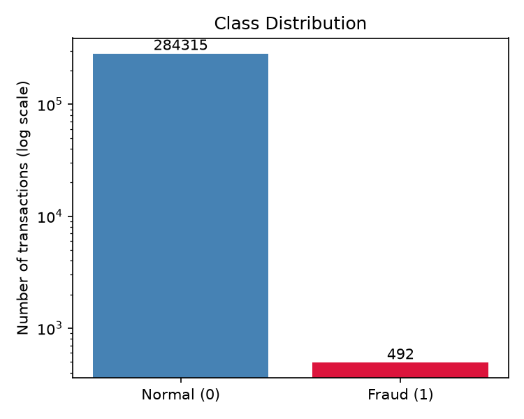
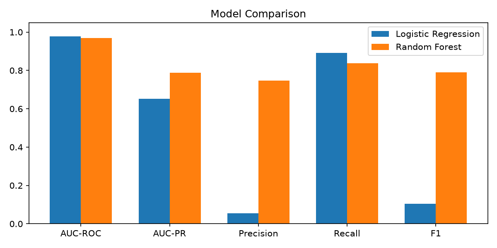
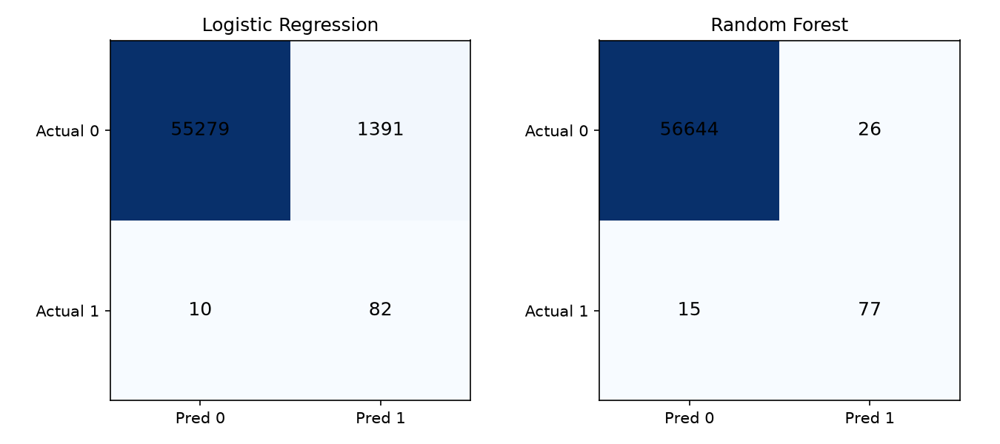
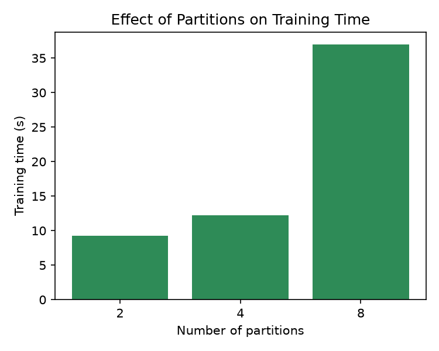

# Credit Card Fraud Detection using Apache Spark MLlib

An end-to-end machine learning project that detects fraudulent credit card transactions using Apache Spark and PySpark MLlib.

## Project Overview

Credit card fraud detection is a highly imbalanced classification problem because fraudulent transactions represent a very small proportion of total transactions.

This project uses distributed data processing and machine learning algorithms to identify potentially fraudulent transactions and compare model performance.

The objective is to build an efficient fraud detection pipeline while exploring the impact of data partitioning on training time.

## Dataset

The project uses a credit card transaction dataset with the following characteristics:

- Total transactions: 284,807
- Fraudulent transactions: Approximately 0.17%
- Problem type: Binary Classification
- Train-test split: 80:20

**Note:** The dataset is not included in this repository because of its large file size.

## Technologies Used

- Python
- Apache Spark
- PySpark MLlib
- Pandas
- NumPy
- Matplotlib
- Scikit-learn

## Machine Learning Workflow

1. **Data Loading and Exploration:** Load the transaction dataset and understand its structure.
2. **Data Preprocessing:** Prepare the data for machine learning and handle class imbalance using class weights.
3. **Feature Engineering:** Use VectorAssembler and StandardScaler to prepare features.
4. **Model Training:** Train Logistic Regression and Random Forest classifiers using PySpark MLlib.
5. **Model Evaluation:** Compare models using Precision, Recall, F1-score and AUC-PR.
6. **Performance Analysis:** Examine the effect of different data partitions on training time.

## Models Implemented

### 1. Logistic Regression

A baseline classification model used to identify potentially fraudulent transactions.

### 2. Random Forest

An ensemble learning algorithm that combines multiple decision trees to improve classification performance.

## Model Performance

| Metric | Random Forest | Logistic Regression |
|---|---:|---:|
| Precision | 0.75 | — |
| Recall | 0.84 | — |
| F1-score | 0.79 | 0.10 |
| AUC-PR | 0.79 | — |

Random Forest achieved a significantly better F1-score than Logistic Regression on this imbalanced dataset.

*Note: Dashes indicate metrics not reported in the current project summary.*

## Project Visualizations

The following visualizations provide insights into class imbalance, model performance, confusion matrices and the impact of partitioning.

### 1. Class Distribution

Shows the difference between legitimate and fraudulent transactions.



### 2. Model Comparison

Compares the performance of the implemented classification models.



### 3. Confusion Matrices

Visualizes the classification results and prediction errors for the models.



### 4. Effect of Partitions on Training Time

Shows how changing the number of partitions affects model training time.



## Performance and Distributed Processing

- Implemented the project using Apache Spark in local mode with 8 cores.
- Experimented with data partitioning to understand its impact on execution time.
- Monitored execution using the Spark UI.
- Compared classification performance using appropriate evaluation metrics.

## Project Structure

```text
Credit-Card-Fraud-Detection-Spark/
|
|-- 1_class_distribution.png
|-- 2_model_comparison.png
|-- 3_confusion_matrices.png
|-- 4_partition_time.png
|
|-- fraud_detection.py
|-- README.md
|-- requirements.txt
|-- .gitignore
```

## How to Run

### Prerequisites

- Python installed
- Apache Spark installed and configured
- Required Python libraries

### Setup Instructions

**1. Clone the repository**

```bash
git clone https://github.com/Priyamshu15/Credit-Card-Fraud-Detection-Spark-MLlib.git
```

**2. Navigate to the project directory**

```bash
cd Credit-Card-Fraud-Detection-Spark-MLlib
```

**3. Install the required libraries**

```bash
pip install -r requirements.txt
```

**4. Place the dataset**

Place the dataset file named `creditcard.csv` in the project directory.

**5. Run the Python script**

```bash
python fraud_detection.py
```

## Key Learnings

- Working with large-scale datasets using Apache Spark.
- Building machine learning pipelines using PySpark MLlib.
- Understanding class imbalance in fraud detection.
- Evaluating classification models using Precision, Recall, F1-score and AUC-PR.
- Exploring distributed processing and data partitioning.
- Monitoring Spark execution using Spark UI.

## Author

**Priyamshu Sahu**

B.Tech – Computer Science and Engineering  
Data Science

GitHub: [Priyamshu15](https://github.com/Priyamshu15)
